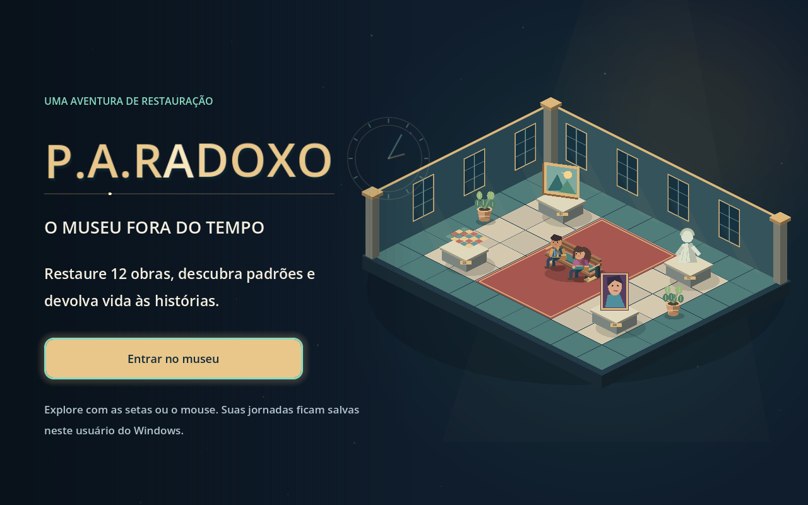
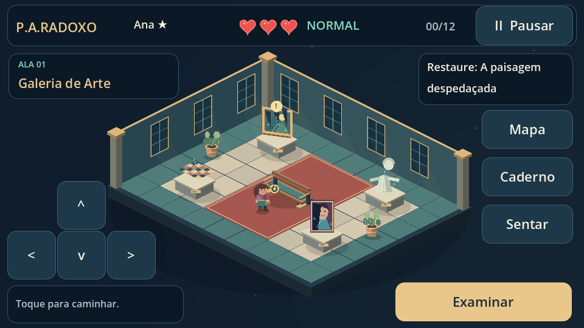
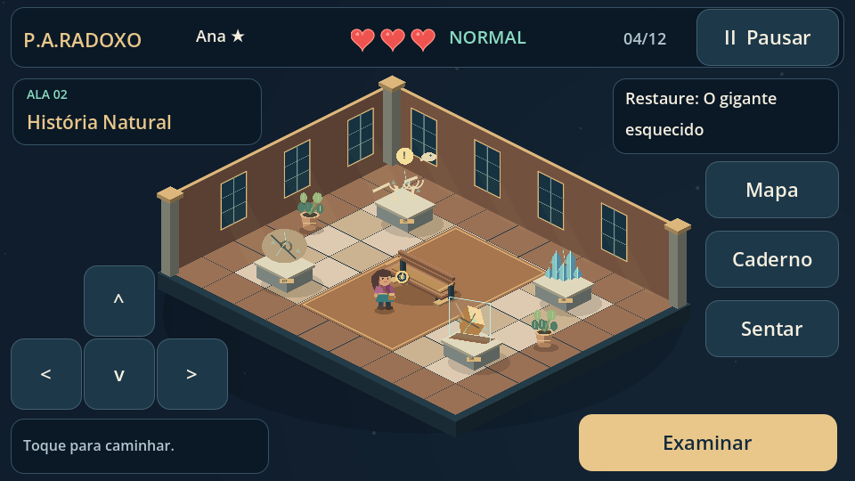
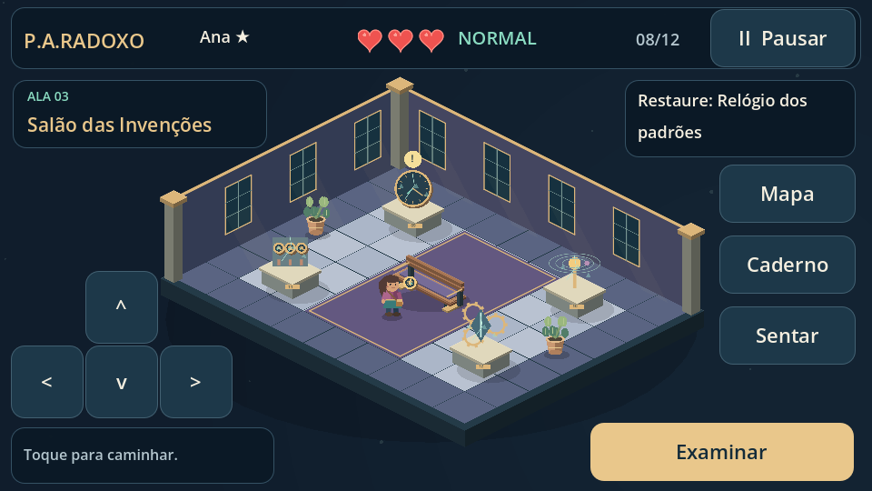
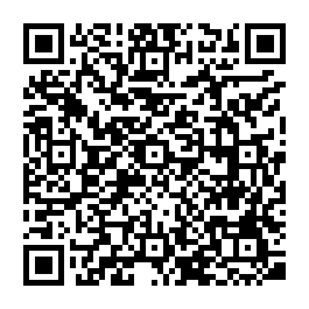

<div align="center">



# P.A.RADOXO — O Museu Fora do Tempo · Game

**Cada descoberta devolve uma história.**

Uma aventura de exploração e restauração em que a matemática faz o tempo voltar a correr.

[](https://mariomont30.github.io/Game_P.A.RADOXO_Museu-Fora-do-Tempo/)
[](https://github.com/mariomont30/Game_P.A.RADOXO_Museu-Fora-do-Tempo/releases/latest/download/PARADOXO-Windows.zip)


[Conheça o jogo](#um-museu-que-precisa-de-você) · [Download](#baixar-e-jogar-no-windows) · [QR code](#jogue-no-celular) · [Controles](#controles) · [Projeto](#por-dentro-do-projeto) · [Equipe](#equipe)

</div>

## Um museu que precisa de você

Na véspera de uma exposição, quadros perdem suas cores e invenções começam a se desfazer. Para proteger o acervo, o Curador aciona o Relógio Central e prende o museu no mesmo instante.

Você chega como aprendiz de restauração. Ao seu lado está **Tico**, um pequeno robô em forma de relógio que orienta os visitantes. Suas memórias se espalharam por três engrenagens. Uma lembrança resistiu: **cada padrão guarda uma pista**.

Explore as salas, resolva desafios de Progressão Aritmética e restaure **12 obras** para devolver ao museu suas histórias e seu amanhã.

| Uma jornada por três alas | O que você vai encontrar |
| --- | --- |
| **01 · Galeria de Arte** | Quadros, mosaicos e esculturas à espera de restauração. |
| **02 · História Natural** | Fósseis, cristais e descobertas sobre o passado. |
| **03 · Salão das Invenções** | Relógios e mecanismos que guardam o fluxo do tempo. |

<table>
<tr>
<td width="33%" align="center"><a href="media/capturas/galeria-arte.png"></a><br><strong>Galeria de Arte</strong></td>
<td width="33%" align="center"><a href="media/capturas/historia-natural.png"></a><br><strong>História Natural</strong></td>
<td width="33%" align="center"><a href="media/capturas/invencoes.png"></a><br><strong>Salão das Invenções</strong></td>
</tr>
</table>

Clique em uma captura para ver os detalhes em tamanho maior.

## Entre no museu

A abertura na Web e no Windows destaca o nome do jogo sobre o cenário do museu, com luz suave, partículas e brilho no botão **Entrar no museu**. Os efeitos respeitam Movimento reduzido. No Windows, a preparação dos desafios e das jornadas começa depois do clique. No celular, o texto cabe na tela sem rolagem e a barra de carregamento fica no topo.

## Cada ala tem sua própria entrada

As primeiras entradas nas três galerias têm apresentações automáticas de 3,8 segundos, com cenário em destaque, título animado, partículas e um efeito sonoro original. A entrada da Ala 1 apresenta a aventura. Nas alas seguintes, a engrenagem recuperada anuncia a nova descoberta. Ao concluir as 12 obras, uma apresentação conduz ao encerramento.

| Ala | Identidade visual |
| --- | --- |
| Galeria de Arte | Verde azulado e dourado |
| História Natural | Areia, terracota e âmbar |
| Salão das Invenções | Violeta, com azul luminoso na apresentação |

Durante a apresentação, os controles ficam bloqueados e o cronômetro fica parado. A exploração começa com o personagem sentado no banco. As visitas a galerias já conhecidas pelo mapa têm passagem breve. Com Movimento reduzido, a apresentação usa dissolução suave, sem partículas, rotação ou aproximação de câmera. Não há opção de pular.

## Baixar e jogar no Windows

### [⬇️ Baixar P.A.RADOXO para Windows — PC e notebook](https://github.com/mariomont30/Game_P.A.RADOXO_Museu-Fora-do-Tempo/releases/latest/download/PARADOXO-Windows.zip)

**Versão portátil para Windows de 64 bits. Não é necessário instalar o Godot.**

1. Baixe o arquivo **PARADOXO-Windows.zip** pelo link acima.
2. Clique com o botão direito no ZIP e escolha **Extrair tudo**.
3. Abra a pasta extraída e execute **PARADOXO.exe**.
4. Mantenha **PARADOXO.pck** na mesma pasta do executável.
5. Na abertura, clique em **Entrar no museu**. Após o carregamento, escolha sua jornada.

Depois de baixar e extrair, a versão Windows pode ser jogada **sem internet**. O computador precisa oferecer suporte a **OpenGL 3.3**. A versão distribuída não possui assinatura digital.

[Ver a versão publicada, notas e arquivos de verificação →](https://github.com/mariomont30/Game_P.A.RADOXO_Museu-Fora-do-Tempo/releases/latest)

Prefere jogar sem baixar? **[Abra o jogo no navegador](https://mariomont30.github.io/Game_P.A.RADOXO_Museu-Fora-do-Tempo/)**.

## Jogue no celular

<div align="center">

<a href="https://mariomont30.github.io/Game_P.A.RADOXO_Museu-Fora-do-Tempo/">

</a>

**Aponte a câmera, abra o link e entre no museu.**

[Abrir o jogo](https://mariomont30.github.io/Game_P.A.RADOXO_Museu-Fora-do-Tempo/) · [Baixar QR code em PNG](media/qr-code.png) · [QR code em SVG](media/qr-code.svg)

</div>

No celular, jogue **na horizontal**. Toque em **Entrar no museu**, informe seu nome, escolha um personagem e selecione um modo. Use os direcionais e os botões de toque; arraste os textos para rolar. O primeiro carregamento depende da conexão.

## Aprender enquanto explora

- **4.200 questões**, com 2.100 por modo e 300 por conteúdo. As respostas positivas, negativas e zero têm a mesma distribuição nos dois modos.
- Sequências, registros, tabelas, mecanismos e restaurações apresentam os desafios de formas diferentes. O Difícil exige mais etapas de raciocínio.
- O sorteio evita questões já vistas na jornada, varia os formatos e equilibra as posições corretas sem ciclos fixos. Pausar ou retomar preserva a ordem das alternativas.
- Reconhecimento e classificação de P.A., continuação de sequências, razão, termo geral, primeiro termo, posição e soma.
- **Caderno de Tico** com explicações, fórmulas e exemplos; dicas para apoiar a resolução.
- Obras restauradas podem ser observadas em destaque, com sua aparência recuperada.
- Dois personagens, trilhas próprias para cada ambiente e créditos com as galerias ao fundo.
- Opções de **texto ampliado**, **movimento reduzido** e ajustes de volume.

| Modo | Vidas | Tempo | Experiência |
| --- | :---: | --- | --- |
| **Normal** | 3 corações | Sem limite | Explore e resolva no seu ritmo. |
| **Difícil** | 2 corações | Cronômetro por questão | Resolva os desafios antes de o tempo terminar. |

Cada coração vermelho representa uma vida. Ao perder uma vida, um coração fica apagado. Erros novos e confirmados custam uma vida. No Difícil, o tempo esgotado também custa uma vida. Dicas não gastam vidas, e o caderno mantém o cronômetro ativo no Difícil. **Próxima pergunta mantém os corações e a tentativa extra que restam, sem recuperar nem acumular vidas.**

**GAME OVER:** ao esgotar os corações pela primeira vez em um desafio, você pode usar uma tentativa extra. Ela começa com **três corações no Normal ou dois no Difícil**, outra questão do mesmo conteúdo e, no Difícil, tempo renovado. **Ao acertar uma pergunta, todos os corações voltam e a tentativa extra é renovada para o próximo desafio.** Se esgotar os corações novamente antes de acertar, todo o progresso dessa jornada será apagado e o jogo voltará à tela inicial. Pausar, trocar a pergunta, voltar ao menu ou fechar o jogo não renovam as chances. Outras jornadas e configurações são preservadas.

No final, **Meu aprendizado** mostra um resumo e cards por conteúdo, com acertos sem ajuda, acertos com ajuda, erros, questões puladas e tempo esgotado. O painel permite consultar o Caderno de Tico e adapta as colunas para a tela do celular.

## Controles

| Ação | Computador | Celular |
| --- | --- | --- |
| Caminhar | Setas do teclado ou clique no chão | Direcionais ou toque no chão |
| Aproximar-se de uma obra | Clique na obra | Toque na obra |
| Examinar | Botão **Examinar** ou tecla **E** | Botão **Examinar** |
| Sentar no banco | Clique no banco ou em **Sentar** | Toque no banco ou em **Sentar** |
| Pausar e retomar | **Esc**, **Enter** ou botões da tela | Botões da tela |
| Navegar nos menus | Setas; **Espaço** ativa; **Tab** alterna o foco | Toque nas opções |
| Rolar textos | Roda do mouse, setas em foco ou Page Up/Down | Arraste o conteúdo |
| Alternar tela cheia | **F11** ou Configurações | Entrada automática quando permitida pelo navegador |

Ao pausar a exploração, o personagem caminha até o banco e senta; então o jogo pausa. Ao retomar, ele se levanta. Sentar por escolha própria não pausa a partida. Nos créditos, **Pausar** interrompe somente as letras; no celular, **Retornar aos créditos** continua a leitura.

As jornadas em andamento ficam salvas **no dispositivo e no navegador usados**. Uma jornada encerrada por duas derrotas antes de um novo acerto é removida do salvamento, inclusive na recuperação por backup. O progresso da Web não é sincronizado automaticamente com Windows, outro navegador ou outro celular.

## Por dentro do projeto

```text
.
├── README.md                   # Apresentação, acesso e download
├── index.html                  # Entrada estável do jogo online
├── game/                       # Projeto Godot editável
│   ├── scripts/                # Interface, exploração e restauração
│   ├── data/                   # Banco de questões
│   ├── audio/                  # Músicas e efeitos
│   ├── fonts/                  # Fontes e licenças
│   ├── web/                    # Fontes da entrada móvel
│   └── tools/                  # Geradores dos recursos
├── web/                        # Motor, pacote e recursos do navegador
├── docs/                       # Guia, desenvolvimento e organização
│   ├── CHANGELOG.md            # Novidades de cada versão
│   ├── academico/              # Projeto e roteiro da apresentação
│   └── referencias/            # Gabaritos para consulta
├── media/                      # QR code e capturas do jogo
├── licenses/                   # Licenças e avisos de terceiros
├── tools/                      # Preparação Web e pacotes
├── tests/                      # Testes automáticos
│   └── visual/                 # Roteiros de captura de telas
└── .github/workflows/          # Verificação e publicação
```

Os recursos da Web ficam em `web/`. O `index.html` da raiz mantém o mesmo endereço público e usa esses recursos sem redirecionar o jogador. Executáveis e ZIPs para jogadores ficam nas **[Releases](https://github.com/mariomont30/Game_P.A.RADOXO_Museu-Fora-do-Tempo/releases)**, separados do código-fonte.

Para editar, abra **[game/project.godot](game/project.godot)** no **Godot 4.7.2**. [Leia as instruções de desenvolvimento e exportação](docs/DESENVOLVIMENTO.md).

**Documentação:** [Guia do jogador](docs/GUIA-DO-JOGADOR.md) · [Organização e manutenção](docs/ORGANIZACAO.md) · [Projeto acadêmico](docs/academico/PROJETO.md) · [Novidades](docs/CHANGELOG.md) · [Licenças](licenses/README.md)

## Equipe

| Integrantes |
| --- |
| Mário Monteiro |
| Bruno Gonçalves |
| Ana Gabriella |
| José Cleidson |

**Universidade de Fortaleza · Centro de Ciências Tecnológicas**  
**Disciplina:** Res problemas nat discreta  
**Professor:** Rubens Rodrigues

---

<div align="center">

**O museu continua vivo enquanto alguém tem curiosidade.**

[Jogar agora](https://mariomont30.github.io/Game_P.A.RADOXO_Museu-Fora-do-Tempo/) · [Baixar para Windows](https://github.com/mariomont30/Game_P.A.RADOXO_Museu-Fora-do-Tempo/releases/latest/download/PARADOXO-Windows.zip)

</div>
